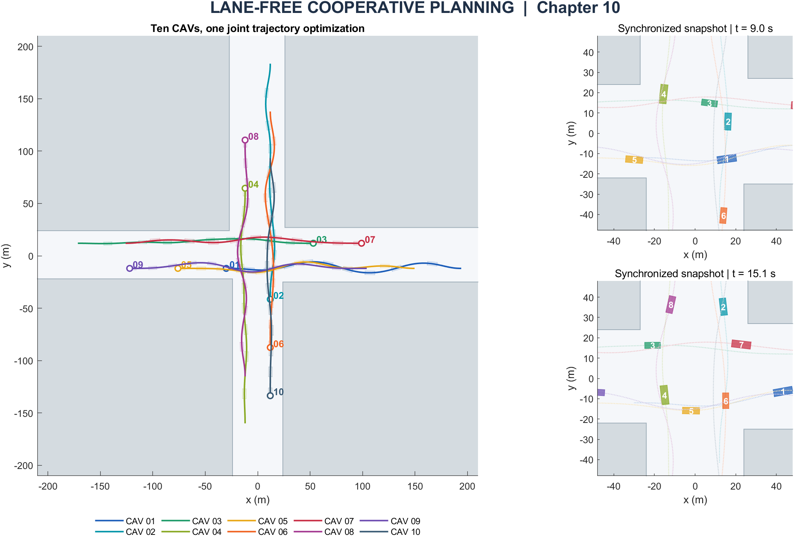
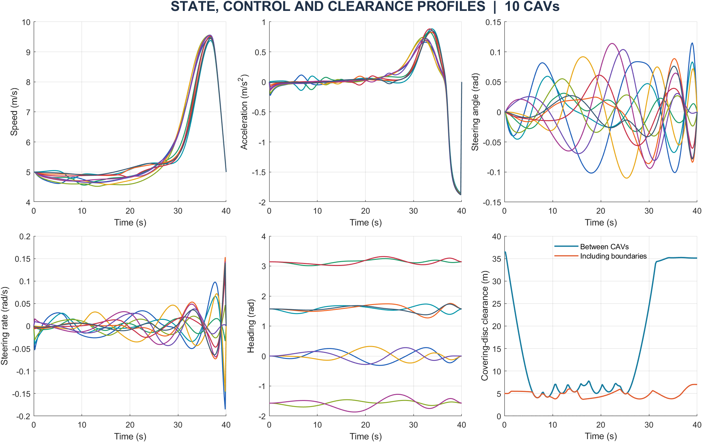
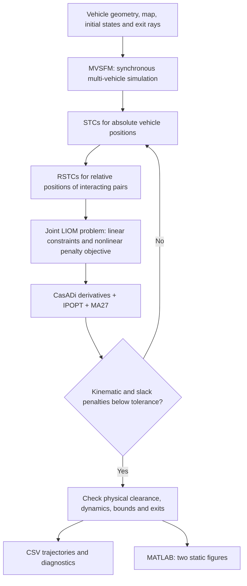

# Lane-Free Cooperative Trajectory Planning

**10 heterogeneous CAVs · C++ and MATLAB · CasADi / IPOPT / MA27**

Companion code for **Chapter 10 of the Chinese-language book《非结构化场景自动驾驶轨迹规划技术》** — *Trajectory Planning Techniques for Autonomous Driving in Unstructured Environments* (English rendering of the Chinese title). This chapter studies cooperative trajectory planning at unstructured, unsignalized intersections: vehicles share the intersection space while avoiding one another and respecting vehicle kinematics.



*An actual MATLAB run of the supplied ten-vehicle example. Colors identify vehicles; pale rectangles show body footprints. Each snapshot displays vehicles at the same instant. Crossings between complete spatial paths do not imply simultaneous collisions.*

## Research background and citation

Please cite **both papers** when using this chapter's companion code. The metaverse paper is listed first as the related lane-free intersection-management foundation; the 2025 paper supplies the MVSFM, STC/RSTC and LIOM trajectory-planning framework implemented here.

1. **B. Li, D. Cao, S. Tang, T. Zhang, H. Dong, Y. Wang, and F.-Y. Wang**, “Sharing Traffic Priorities via Cyber–Physical–Social Intelligence: A Lane-Free Autonomous Intersection Management Method in Metaverse,” *IEEE Transactions on Systems, Man, and Cybernetics: Systems*, **vol. 53, no. 4, pp. 2025–2036, Apr. 2023**, doi: [10.1109/TSMC.2022.3225250](https://doi.org/10.1109/TSMC.2022.3225250). **First published online on December 13, 2022**; use **2023** for the final journal-volume citation.
2. **F. Bu, B. Li, P. Chen, G. Yu, and Y. Wang**, “Real-Time Cooperative Trajectory Planning for Multiple CAVs at Unstructured Intersections: A Computational Optimal Control Approach,” *IEEE Transactions on Intelligent Transportation Systems*, **vol. 26, no. 11, pp. 18963–18977, Nov. 2025**, doi: [10.1109/TITS.2025.3597472](https://doi.org/10.1109/TITS.2025.3597472).

Copy-ready BibTeX is provided [below](#bibtex) and in [CITATION.bib](CITATION.bib).

## What the example computes

Ten vehicles enter from four approaches, with three different vehicle geometries. Unequal corner boundaries define the free space. **All ten trajectories are optimized jointly**, including potentially interacting pairs.

The example uses a **40 s horizon and 200 configurations per vehicle**. A run builds an initial guess, constructs safe corridors, repeatedly solves the cooperative optimization problem, validates the trajectories and exports numerical results. MATLAB also opens **exactly two static figures**:

1. Cooperative trajectories, body footprints and synchronized intersection snapshots.
2. Speed, acceleration, steering angle, steering rate, heading and clearance histories.



The C++ and MATLAB versions implement the same scene, equations, bounds and solver settings. MATLAB performs its own optimization; it does not call the C++ program or load a saved answer. Neither version uses AMPL. This repository demonstrates **one cooperative cluster**; the papers also address the wider intersection-management setting, including priority sharing and successive clusters.

## Method and architecture



### Vehicle model and boundary conditions

Each vehicle has rear-axle position $(x_i,y_i)$, speed $v_i$, heading $\theta_i$, steering angle $\phi_i$, acceleration $a_i$ and steering rate $\omega_i$. The bicycle equations are

$$
\dot x_i=v_i\cos\theta_i,\quad \dot y_i=v_i\sin\theta_i,\quad
\dot v_i=a_i,\quad \dot\theta_i=v_i\tan\phi_i/L_{Wi},\quad \dot\phi_i=\omega_i.
$$

Initial states and controls are fixed. Terminal speed, heading, acceleration, steering angle and steering rate are specified. The terminal position lies **on an outbound ray beyond the exit**, allowing vehicles to continue away from the intersection. The desired target in the objective lies beyond the distance reachable during the horizon.

### MVSFM initialization

The multi-vehicle social-force model combines attraction toward the second forward guiding point with exponential repulsion from other vehicles and boundaries. Equation (25) determines the bounded steering angle directly; synchronous simulation updates all vehicles from the same time slice. The result initializes both the NLP and its corridors. Steering-rate consistency is enforced during optimization.

### Absolute and relative safe travel corridors

An auxiliary center $(x_i^c,y_i^c)$ and a covering disc represent each rectangular vehicle. The center follows Eq. (10a); its covering radius is the rectangle's geometric half-diagonal.

- An **STC** confines a vehicle center to axis-aligned boxes that remain clear of the road boundaries.
- An **RSTC** confines $(x_i^c-x_j^c,y_i^c-y_j^c)$ outside the pair's collision disc.
- A nonnegative slack variable temporarily relaxes each relative box; a linear penalty discourages residual conflicts.

Boxes expand in the up/down/left/right sequence. Pairs whose absolute corridors cannot bring their discs into contact are omitted from that subproblem. Final validation still checks **all 45 vehicle pairs**.

### LIOM optimization

The normal cost rewards smooth controls and progress toward the desired targets:

$$
J_{\rm norm}=\sum_i\left[w_{\rm smo}\int_0^{T_f}(a_i^2+\omega_i^2)\,dt+
\|(x_i(T_f),y_i(T_f))-(x_i^d,y_i^d)\|_2^2\right].
$$

The nonlinear differential equations and disc-center identities are softened into squared residuals. Each subproblem minimizes $J_{\rm norm}+J_{\rm slack}+J_{\rm kinematics}$ subject to **linear corridor, state/control bound and boundary constraints**. The current trajectories guide the next set of corridors. Acceptance requires

$$J_{\rm slack}+J_{\rm kinematics}\leq10^{-6},$$

followed by physical clearance checks using centers recomputed from $(x,y,\theta)$.

### Equation-to-source map

| 2025 paper component | C++ | MATLAB |
|---|---|---|
| Bicycle dynamics and bounds, Eqs. (2)–(3) | `src/simulation.cpp`, `src/optimization.cpp` | `SimulateMVSFM.m`, `OptimizeLIOM.m` |
| Initial states and exit rays, Eqs. (5)–(7) | `src/scenario.cpp`, `src/optimization.cpp` | `CreateScenario.m`, `OptimizeLIOM.m` |
| Smoothness/progress objective, Eq. (8) | `src/optimization.cpp` | `OptimizeLIOM.m` |
| Auxiliary center, Eq. (10a) | `src/scenario.cpp` | `CreateScenario.m`, `ValidateSolution.m` |
| STC/RSTC, Algorithms 1–2 | `src/corridors.cpp` | `BuildCorridors.m` |
| Relative slack, Eqs. (18)–(19) | `src/optimization.cpp` | `OptimizeLIOM.m` |
| MVSFM forces/steering, Eqs. (21)–(25) | `src/simulation.cpp` | `SimulateMVSFM.m` |
| LIOM, Eqs. (26)–(29), Algorithm 3 | `src/optimization.cpp` | `OptimizeLIOM.m` |

## Install the numerical dependencies

Both versions use **CasADi, IPOPT and HSL MA27**. MA27 is selected explicitly by default. Missing MA27 support produces an error; the code does not silently substitute another solver.

1. Obtain **CasADi 3.7.2** from the [official downloads](https://web.casadi.org/get/). For MATLAB, choose the MATLAB package for your OS. For C++, use an SDK with headers, link library, CMake package and IPOPT plugin.
2. Install a compatible **HSL library containing MA27**, for example from the [official Coin-HSL distribution](https://licences.stfc.ac.uk/product/coin-hsl), following its installation and license terms. HSL is not redistributed here.
3. Set **`HSL_LIBRARY`** to the shared library's full path and expose its runtime dependencies to the dynamic loader. The code passes that path to IPOPT's [`hsllib` option](https://coin-or.github.io/Ipopt/OPTIONS.html#OPT_hsllib). It can be omitted when your IPOPT already links MA27 directly.

Use compatible architectures and compiler runtimes. In particular, a MinGW C++ SDK cannot be substituted for an MSVC SDK. A DLL alone is not a complete CasADi C++ installation.

### MATLAB: one run, two figures

Validated with MATLAB R2021b and the official CasADi 3.7.2 MATLAB package. No MATLAB optimization toolbox is needed.

```matlab
% One-time setup: replace these installation paths.
addpath('C:\path\to\casadi-3.7.2-windows64-matlab2018b');
setenv('HSL_LIBRARY','C:\path\to\hsl\libcoinhsl-2.dll');
setenv('PATH',['C:\path\to\hsl;' getenv('PATH')]);

% Open RunMe.m and press Run, or execute:
cd('C:\path\to\AIM_2025\matlab');
result = RunMe;
```

Alternatively, set `CASADI_MATLAB_PATH` to the extracted CasADi package directory; `RunMe` adds it automatically. On Linux, select the Linux MATLAB package and HSL `.so`, and configure `LD_LIBRARY_PATH` before starting MATLAB if needed.

Outputs appear in `matlab/results/`. Edit `CreateScenario.m` to change the scene or task; the state order is documented in that file.

### C++: configure, build and run

Requirements: a **C++17 compiler**, **CMake 3.16+**, a compatible CasADi C++ SDK and MA27.

Linux:

```bash
git clone https://github.com/libai1943/AIM_2025.git
cd AIM_2025
export HSL_LIBRARY=/absolute/path/to/libcoinhsl.so
export LD_LIBRARY_PATH=/absolute/path/to/casadi:/absolute/path/to/hsl:$LD_LIBRARY_PATH
cmake -S . -B build -DCMAKE_BUILD_TYPE=Release \
  -Dcasadi_DIR=/absolute/path/to/casadi/cmake
cmake --build build -j
./build/aim_demo --output results
```

Windows / MinGW-w64, in PowerShell:

```powershell
$env:HSL_LIBRARY = 'C:\path\to\hsl\libcoinhsl-2.dll'
$env:PATH = 'C:\path\to\casadi;C:\path\to\hsl;C:\path\to\mingw64\bin;' + $env:PATH
cmake -S . -B build -G 'MinGW Makefiles' -DCMAKE_BUILD_TYPE=Release -Dcasadi_DIR=C:/path/to/casadi/cmake
cmake --build build
.\build\aim_demo.exe --output results
```

For system installations, `casadi-config.cmake` may be under `<prefix>/lib/cmake/casadi`; use the actual path. An MSVC build needs its matching SDK and usually places the executable in `build/Release/`.

`--linear-solver ma27` explicitly restates the default. With the same environment, `ctest --test-dir build --output-on-failure` runs the numerical example. C++ exports results without opening graphics windows.

## Files and responsibilities

| File | Purpose |
|---|---|
| `include/aim/planner.hpp` | C++ state, parameter, geometry, corridor and solution types |
| `src/main.cpp` | Entry point, solver selection, orchestration, CSV output and errors |
| `src/scenario.cpp` | Ten-vehicle scene, body geometry and physical clearance |
| `src/simulation.cpp` | Synchronous MVSFM initialization |
| `src/corridors.cpp` | STC/RSTC expansion and interacting-pair selection |
| `src/optimization.cpp` | Joint symbolic NLP, LIOM iterations, MA27 and acceptance checks |
| `CMakeLists.txt` | C++ build and numerical test |
| `matlab/RunMe.m` | One-click computation, validation, output and two figures |
| `matlab/CreateScenario.m` | Matching scene, vehicles, conditions and parameters |
| `matlab/SimulateMVSFM.m` | MATLAB forward-simulation initializer |
| `matlab/BuildCorridors.m` | Absolute and relative corridor construction |
| `matlab/OptimizeLIOM.m` | MATLAB/CasADi joint NLP and LIOM loop |
| `matlab/ValidateSolution.m` | Independent dynamics, all-pair clearance, bound and endpoint checks |
| `matlab/ExportResults.m` | Full-precision CSVs and MATLAB result archive |
| `matlab/PlotResults.m` | Static trajectory/footprint and state/control figures |
| `docs/images/` | Actual run images used in this README |
| `CITATION.bib` | Both journal references |

| Output | Contents |
|---|---|
| `trajectories.csv` | `vehicle,t,x,y,v,a,phi,omega,theta,xc,yc` at every configuration |
| `iterations.csv` | Iteration, penalty, normal cost, weighted kinematic cost, slack cost, infeasibility |
| `solution.mat` (MATLAB) | Scene, initial guess, optimized trajectories and validation metrics |
| `cooperative_trajectories.png` (MATLAB) | Trajectories, footprints and synchronized snapshots |
| `state_control_profiles.png` (MATLAB) | State, control and clearance histories |

Lengths, times and angles use metres, seconds and radians. Failed optimization or feasibility checks produce an error rather than labeling the result successful.

## Parameters and reproducibility

Settings from Table II of the 2025 paper:

| Parameter | Value |
|---|---:|
| Horizon / configurations per vehicle | 40 s / 200 |
| Maximum LIOM solves / infeasibility threshold | 6 / 1e-6 |
| Smoothness weight / initial kinematic penalty | 0.001 / 200 |
| Attractive / repulsive weights | 0.001 / 0.6 |
| Turning coefficient | 0.6 |
| Speed / acceleration bounds | [3, 10] m/s / ±2 m/s² |
| Steering / steering-rate bounds | ±0.4 rad / ±0.3 rad/s |

The supplied map and ten-vehicle task are a constructed demonstration. Numerical conventions are explicit:

- **Discretization:** 200 endpoint-inclusive configurations, forward Euler, `dt = 40/199`, and rectangular quadrature for control and differential-residual terms.
- **Guiding routes:** straight boundary-feasible, zero-control-cost individual routes on a 2 m grid. Optimized trajectories can deviate from them.
- **Force conversion:** unit-mass longitudinal projection and a 0.5 m exponential distance scale. These details are not fully specified in the paper.
- **Corridors:** 0.25 m expansion steps and 5 m per-side limits. A temporarily unsafe soft iterate receives a nearby safe seed.
- **Penalty continuation:** initial weight 200, multiplied by 200 after an unsuccessful iteration. This implements the external-penalty limit; the multiplier is a demo setting, not a Table II value.
- **NLP solution:** constant objective scaling, Gauss–Newton curvature for squared residuals, adaptive IPOPT barrier updates and explicit MA27. Later penalty stages use tighter tolerances. Relative slack is reduced to its smallest feasible value at the computed states before acceptance.

Both versions were executed on Windows with CasADi 3.7.2 and MA27, using GCC 16.2 and MATLAB R2021b. Independent recomputation checked **2,000 configurations and all 45 vehicle pairs**, including dynamics, body coverage, bounds and exit rays. Both completed six LIOM solves with zero final relative slack, weighted infeasibility below `2e-7` and minimum covering-disc clearance approximately **3.72 m**. Their exported rear-axle positions differed by at most approximately **0.00012 m**.

These are results of this example, not the papers' benchmark statistics. Validation concerns discrete configurations and the Euler model. Linux instructions describe deployment; execution was verified on Windows. Priority trading and the full multi-cluster reservation system are outside this single-cluster example.

## BibTeX

```bibtex
@article{li2023metaverse,
  author  = {Li, Bai and Cao, Dongpu and Tang, Shiqi and Zhang, Tantan
             and Dong, Hairong and Wang, Yaonan and Wang, Fei-Yue},
  title   = {Sharing Traffic Priorities via Cyber--Physical--Social Intelligence:
             A Lane-Free Autonomous Intersection Management Method in Metaverse},
  journal = {IEEE Transactions on Systems, Man, and Cybernetics: Systems},
  year    = {2023},
  volume  = {53},
  number  = {4},
  pages   = {2025--2036},
  doi     = {10.1109/TSMC.2022.3225250}
}

@article{bu2025cooperative,
  author  = {Bu, Fan and Li, Bai and Chen, Peng and Yu, Guizhen and Wang, Yunpeng},
  title   = {Real-Time Cooperative Trajectory Planning for Multiple CAVs at
             Unstructured Intersections: A Computational Optimal Control Approach},
  journal = {IEEE Transactions on Intelligent Transportation Systems},
  year    = {2025},
  volume  = {26},
  number  = {11},
  pages   = {18963--18977},
  doi     = {10.1109/TITS.2025.3597472}
}
```

Also follow [CasADi's citation guidance](https://web.casadi.org/docs/#citing-casadi) for work using its numerical framework.
